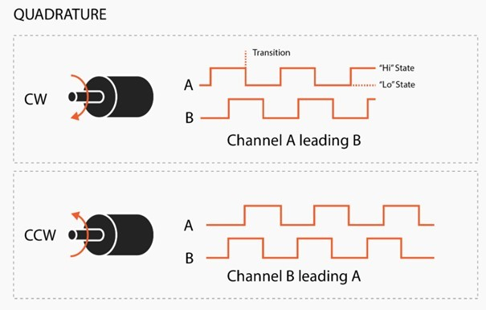

# Encoder ile Pulse Sayma, Yön ve RPM Hesaplama (STM32F401RE)

Demsay Elektronik Gömülü Yazılım Mühendisi pozisyonu için hazırlanan teknik çalışma.

A/B kanallı artımlı bir encoder'dan gelen pulse'lar STM32F401RE üzerinde sayılır. Dönüş yönü ve
RPM her saniye hesaplanıp UART üzerinden gönderilir. Kod NUCLEO-F401RE kartında Keil uVision ile
geliştirildi ve test edildi.

## Donanım ve bağlantılar

Elimde halihazırda bulunan STM32F401RE geliştirme kartına uyugn olarak TestFirmware yazdım. Programın doğru çalışıp çalışmadığını test programım ile kontrol ettim.

Kart: NUCLEO-F401RE (STM32F401RET6, 84 MHz).

| Sinyal | Pin | Nucleo başlığı | Kullanım |
|---|---|---|---|
| Encoder A | PA0 | A0 | TIM2_CH1, encoder modu |
| Encoder B | PA1 | A1 | TIM2_CH2, encoder modu |
| UART TX/RX | PA2 / PA3 | — | USART2, ST-Link sanal COM portu |
| LED | PA5 | LD2 | Her ölçümde yanıp söner |

Encoder'ın GND'si kartın GND'sine bağlanmalı.

1 saniyelik periyot TIM10 ile üretilir (84 MHz / 8400 / 10000). Sistem saati HSI'den PLL ile 84 MHz'e
çıkarılır. Pin ve çevre birimi tanımlarının hepsi [`Common/Inc/board.h`](Common/Inc/board.h) dosyasındadır.

## Derleme ve yükleme

**Keil ile:** `Firmware/MDK-ARM/encoder_rpm.uvprojx` projesini açın, derleyin (F7) ve karta yükleyin (F8).
Projede gerekli tüm HAL ve CMSIS dosyaları bulunur, ek paket kurmak gerekmez. Keil MDK 5.4x ve
Arm Compiler 6 ile denenmiştir.

Geliştirme ortamı olarak Keil uVision'ı, daha önceki projelerimde en çok onunla çalıştığım ve
derleme, yükleme, debug akışında pratik sahibi olduğum için tercih ettim. Kod Keil'e özgü bir şey
kullanmaz; aynı kaynak dosyalar STM32CubeIDE gibi başka bir ortamda da derlenebilir.

**Hazır dosya ile:** `bin/` klasöründe derlenmiş dosyalar vardır. Bunlar her Keil derlemesinde
otomatik olarak güncellenir.

`bin/encoder_rpm.hex`: STM32CubeProgrammer veya ST-LINK Utility ile yüklenebilir.

Yükledikten sonra ST-Link'in sanal COM portunu bir seri terminalde **115200 8N1** ile açın. Örnek çıktı:

```
Demsay encoder case | PPR=100 x4=400 counts/rev | period=1000 ms
T=1 PULSE=400 DELTA=+400 DIR=CW RPM=60.00
T=2 PULSE=1200 DELTA=+800 DIR=CW RPM=120.00
T=3 PULSE=1200 DELTA=+0 DIR=STOP RPM=0.00
T=4 PULSE=800 DELTA=-400 DIR=CCW RPM=60.00
```

| Alan | Anlamı |
|---|---|
| `T` | Açılıştan beri geçen süre (s) |
| `PULSE` | Toplam konum, sayım cinsinden (400 sayım = 1 tur). Geri dönüşte azalır. |
| `DELTA` | Son 1 saniyede sayılan pulse |
| `DIR` | `CW`, `CCW` veya `STOP` |
| `RPM` | Hız (her zaman pozitif, yön `DIR` alanındadır) |

## Encoder sinyalleri ve yön tespiti

Artımlı encoder'ın A ve B çıkışları, aralarında 90° faz farkı olan iki kare dalgadır. Hangi kanalın
önde olduğu dönüş yönünü verir. Bu projede A'nın önde olduğu yön **CW** kabul edilmiştir.



STM32'nin timer'larında bu sinyalleri doğrudan çözen bir encoder modu vardır. TIM2, A ve B'nin
yükselen ve düşen kenarlarının hepsinde sayar (x4 çözünürlük). Bu yüzden tur başına 100 pulse'lık bir
encoder için 1 tur = 400 sayımdır.

Sayma yönünü, bir kanal değiştiği anda diğer kanalın seviyesi belirler:

| Kenar | Diğer kanal | Sayaç |
|---|---|---|
| A ↑ | B = 0 | +1 |
| A ↓ | B = 1 | +1 |
| B ↑ | A = 1 | +1 |
| B ↓ | A = 0 | +1 |
| (yukarıdakilerin tersi) | | −1 |

Bu işi donanım yaptığı için hiçbir kenar kaçmaz ve işlemci yükü oluşmaz. Her kenarda kesme
kullanan (EXTI) bir çözümde yüksek hızda kesme yükü artardı. Girişlerde timer'ın dijital filtresi
açıktır (~3 µs), kısa parazitler sayılmaz.

Yazılım tarafında yön, sayacın bir saniyedeki değişiminin (`DELTA`) işaretinden bulunur:
`DELTA > 0` ise CW, `DELTA < 0` ise CCW. Motorun montaj yönüne göre CW/CCW ters çıkarsa A ve B
kabloları yer değiştirilebilir.

## Çalışma prensibi

**Ölçüm penceresi:** TIM10 her saniye bir kesme üretir. Kesme içinde yalnızca TIM2 sayacının o anki
  değeri ve bir sayaç (tick) kaydedilir. Hesaplama ve UART gönderimi ana döngüde yapılır. Böylece
  ölçüm süresi ana döngünün gecikmesinden etkilenmez ve tam 1 saniye olur.
**Pulse farkı:** `DELTA = (int32_t)(şimdiki_sayaç - önceki_sayaç)`. İşaretsiz çıkarma sayesinde
  32-bit sayaç taşsa bile sonuç doğru çıkar.
**RPM:** `RPM = |DELTA| / 400 × 60 / süre(s)`. Hesap tam sayılarla, 0.01 RPM çözünürlükte yapılır.
  1 saniyelik pencerede ölçülebilen en küçük hız 1 sayım/s = 0.15 RPM'dir.
**Durma:** Bir saniye içinde |DELTA| ≤ 1 ise motor durmuş kabul edilir: `RPM = 0`, `DIR = STOP`.
  ±1'lik eşik, kenarın tam üstünde duran milin titreşimle yarattığı sahte hareketi engeller.
  `PULSE` bu sayımları da izlemeye devam eder.
**UART:** USART2 DMA ile gönderilir. Mesajlar bir halka tampona yazılır, işlemci gönderimin
  bitmesini beklemez.

Kod iki katmanlıdır. `encoder.c`, `sampler.c` ve `uart_tx.c` donanıma erişir. `encoder_calc.c` ve
`report.c` ise saf C'dir ve PC'de test edilebilir.

```
Common/        İki programın ortak kullandığı kod (sürücüler, hesaplama, UART)
Firmware/      Ana program (main.c + Keil projesi)
TestFirmware/  Kart üzerinde test programı (main.c, sinyal üreteci + Keil projesi)
tests/host/    PC birim testleri
Drivers/       ST HAL ve CMSIS (değiştirilmeden)
bin/           Derlenmiş .bin / .hex dosyaları
docs/          Diyagram
```

## Test

### PC testleri

Hesaplama ve çıktı formatı PC'de test edilir: RPM hesabı, sayaç taşması, CW/CCW, durma tespiti,
kaçırılan periyot ve UART satır formatı. Herhangi bir gcc ile derlenir:

```bash
gcc -std=c11 -Wall -Wextra -ICommon/Inc tests/host/test_encoder.c Common/Src/encoder_calc.c Common/Src/report.c -o test_encoder
./test_encoder
```

### Kart üzerinde test

Encoder veya motor olmadan test yapabilmek için ayrı bir test programı yazıldı (`TestFirmware/`).
Program kartın TIM3 timer'ı ile bilinen hızlarda A/B sinyali üretir. Bu sinyal iki kabloyla
encoder girişlerine geri bağlanır:

- PA6 (D12) → PA0 (A0)
- PA7 (D11) → PA1 (A1)

`TestFirmware/MDK-ARM/encoder_test.uvprojx` projesini (ya da `bin/encoder_test.bin` dosyasını)
yükleyip terminali açın. Program önce kabloların doğru takıldığını kontrol eder. Ardından 9 senaryoyu
sırayla çalıştırır: durma, CW 60/600/3000/6000 RPM, CCW 120/1500 RPM, 1 RPM ve "motor durdu".
Her saniyelik ölçüm üretilen sinyalle karşılaştırılır (±1 sayım tolerans). Sonuç UART'a yazılır.
Hepsi geçerse LD2 sürekli yanar.

```
[2/9] CW 60 RPM
  T=6 PULSE=403 DELTA=+400 DIR=CW RPM=60.00
    expect: DELTA=+400.00 DIR=CW RPM=60.00 | period=1000 ms -> ok
```

Test programı yalnızca bu geri besleme bağlantısıyla çalışır. Gerçek bir encoder ile deneme için
ana program (`encoder_rpm`) kullanılmalıdır.

Not: Sinyal üreteci ve ölçüm aynı saat kaynağını kullanır. Bu nedenle test, saat kaynağının mutlak
doğruluğunu ölçmez. HSI'nin ±%1 toleransı RPM'e aynı oranda yansır. Daha hassas ölçüm için kristal
(HSE) kullanılabilir.

## Notlar

- Çalışmada istendiği şekilde "tur başına 100 pulse", encoder'ın her kanalda turda 100 pulse ürettiği şeklinde
  yorumlandı. x4 sayım ile bu 400 sayım/tur eder. Değer [`encoder_config.h`](Common/Inc/encoder_config.h)
  dosyasından değiştirilebilir.
- TIM2 32-bit bir sayaçtır ve yüksek hızda taşabilir (6000 RPM'de yaklaşık 30 saatte bir).
  Fark `(int32_t)(şimdiki - önceki)` şeklinde işaretsiz çıkarmayla alındığı için taşma anında da
  sonuç doğru çıkar. Toplam konum (`PULSE`) bu farkların 64-bit bir değişkende toplanmasıyla tutulur.

## Kaynaklar

`Drivers/` altındaki dosyalar değiştirilmeden kopyalanmıştır. Keil'in güncel STM32F4 paketleri HAL'i
yalnızca CubeMX üzerinden sunduğu için RTE yerine bu yol seçildi.

- STM32F4xx HAL Driver v1.8.1 ve CMSIS Device F4 v2.6.8: Keil `STM32F4xx_DFP` 2.17.1 paketinden alındı.
  Kaynak: <https://github.com/STMicroelectronics/stm32f4xx-hal-driver>,
  <https://github.com/STMicroelectronics/cmsis-device-f4> (BSD-3-Clause / Apache-2.0)
- CMSIS-Core 6.1: Arm `ARM.CMSIS` 6.3.0 paketinden alındı.
  Kaynak: <https://github.com/ARM-software/CMSIS_6> (Apache-2.0)
- `stm32f4xx_hal_conf.h`, ST'nin şablon dosyasından türetildi. Yalnızca kullanılan modüller açık.

Referans dokümanlar:

- RM0368: STM32F401xB/C/D/E Reference Manual (Encoder interface mode)
- DS10086: STM32F401xD/xE Datasheet
- UM1724: STM32 Nucleo-64 Boards User Manual
- UM1725: Description of STM32F4 HAL and Low-Layer Drivers
